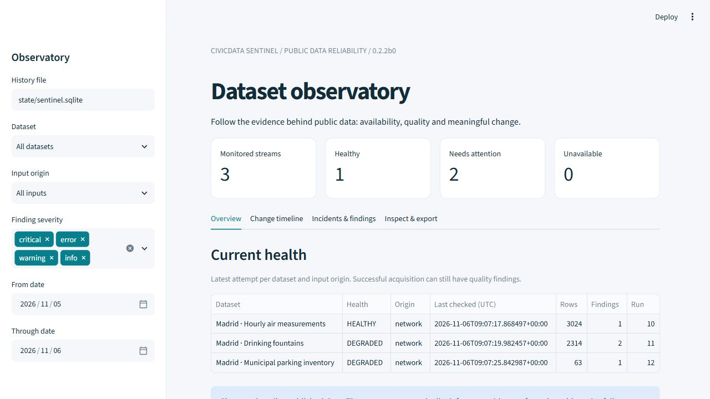

# CivicData Sentinel

[](https://github.com/GerardoLauro/CivicData-Sentinel/actions/workflows/ci.yml)
[](LICENSE)
[](CHANGELOG.md)

**Explainable monitoring and replayable evidence for public datasets.**

Public feeds can change structure, publish partial snapshots or silently revise
records. CivicData Sentinel separates acquisition failures, meaningful changes
and quality findings, keeping an auditable trusted baseline.

## Features

- CSV, CKAN discovery/DataStore pagination and flat JSON feeds.
- Validated YAML contracts, composite keys, schema profiles and conditional checks.
- Completeness, uniqueness, domains, numeric limits/revisions and freshness rules.
- Numeric equivalence/tolerances and rolling-window expiration, explicitly configured.
- Quarantine and reviewed approval: suspicious publications cannot silently replace trust.
- Full events, compressed input artifacts, SHA-256 integrity and offline semantic replay.
- Deduplicated incident lifecycle and cursor-based outbox; no external messages by default.
- Read-only Streamlit dashboard with dataset/date/severity filters and complete exports.
- Hourly monitoring with portable state persisted separately from source commits.



The screenshot is from the local application and contains actual stored network
observations. It does not depict a hosted dashboard.

## Architecture

```text
HTTPS feed -> bounded acquisition -> parse/normalize -> structural gate
    -> quality checks + semantic diff -> trust decision
    -> transactional SQLite audit -> CLI / JSON exports / Streamlit
```

Python 3.11+, HTTPX, PyYAML, Pydantic, filelock, SQLite and Streamlit.
The engine is deterministic and independent of CivicWater; no AI service is needed.

## Installation and quick start

From the repository root:

```bash
python -m venv .venv
# Linux/macOS: source .venv/bin/activate
# Windows PowerShell: .venv/Scripts/Activate.ps1
python -m pip install -e '.[test,dashboard,dev]'
sentinel catalog
sentinel run-all
streamlit run dashboard/app.py
```

Windows users can run `Start-Dashboard.cmd` after installation. The dashboard is a
local application; this repository does not deploy a public dashboard service.

## Included datasets

| Contract | Source | Interpretation |
| --- | --- | --- |
| madrid_fountains | Ayuntamiento de Madrid drinking fountains | Inventory and published operational state |
| madrid_air | Madrid provisional hourly air measurements | Validity-qualified readings; unavailable slots are not valid zeros |
| madrid_parking | Madrid municipal parking facilities | Inventory, not real-time occupancy |

Counts vary over time. Captured v0.2.1 checks contained 2,314 fountains, 63 parking
facilities and 126 air rows expanded into 3,024 hourly slots. These are historical
observations, not promises of current source availability or environmental safety.

## CLI

```bash
sentinel run --config configs/madrid_air.yaml
sentinel history --dataset madrid_air --limit 30 --offset 0
sentinel show --run 1
sentinel export --run 1 --format json --output reports/full.json
sentinel export --run 1 --format csv --output reports/events.csv
sentinel replay --run 1
sentinel verify
python scripts/operational_summary.py --db state/sentinel.sqlite
sentinel backup --output backups/history.sqlite
sentinel incidents --state open
sentinel alerts --after 0
sentinel approve --run 7 --reason 'Reviewed publication and confirmed intended change'
```

Exit codes: 0 accepted, 1 failed, 2 quarantined, 3 an explicitly requested
`--fail-on` threshold was reached. Warnings are normally accepted. Local CSV input
uses a separate stream: `sentinel run --input tests/fixtures/fountains_base.csv
--db demo/state.sqlite --output demo/report.json`. This example is synthetic.

## Add a dataset

Copy [examples/public_csv.yaml](examples/public_csv.yaml), replace the placeholder
URL and declare stable keys, source license and sensible checks. Existing supported
formats need no core-code change. Validate with `sentinel catalog --configs configs`.
The full editor schema is [docs/config.schema.json](docs/config.schema.json).
See [example outcomes](docs/examples.md) for abbreviated, clearly labelled output.

## Testing and reproducibility

```bash
python -m pytest --cov=civicdata_sentinel
python -m ruff check src tests dashboard scripts
python -m ruff format --check src tests dashboard scripts
python -m pip check
python -m pip_audit --skip-editable
python -m build
python scripts/verify_catalog_live.py --output reports/new-live-check
python scripts/verify_workflow_local.py --output reports/new-runner-check
python scripts/benchmark_semantics.py --output reports/benchmark.json
```

Use new directories for live/runner checks. Live tests use actual network data;
unit and local-runner faults are synthetic. Reproducibility bundles are release
assets, described in [evidence/README.md](evidence/README.md). Historical evidence
and existing Git tags remain intact. Failed cross-format comparisons are reported,
never silently skipped. Replay explicitly lists verified levels and exclusions.

## Operation and limitations

The scheduled monitor runs at minute 7 of each UTC hour, subject to GitHub delays.
See [operational instructions](docs/operations.md) and the explicit
[public-state assessment](docs/public-state-assessment.md). The public state branch
contains only public network acquisitions with reviewed licensing. Private feeds
require private external storage. State grows without automatic retention.

API pagination is not transactionally isolated. Limits: 20 MB acquisition,
100,000 normalized rows, 250 MB portable state. One host serializes writers.
Schema types are inferred, and numeric bounds are sanity checks, not legal limits.
Yearly resource IDs require maintenance. Dashboard history displays a bounded
1,000-attempt window; CLI history is paginated and complete events are exportable.
Ambiguous autumn hours are rejected unless the source's fold is explicitly known.
Storage integrity is not semantic attestation; replay does not certify provenance,
all report findings, incident transitions or historical network availability.

[Operational validation](docs/publication-validation.md) records observed runs,
artifacts and unresolved gates. Final commit/run links are also in release notes;
configured workflows must not be mistaken for executed/scheduled observations.

## Development, security and license

[Architecture](docs/architecture.md) · [Design decisions](docs/design-decisions.md) ·
[Contributing](CONTRIBUTING.md) · [Security](SECURITY.md) · [Changelog](CHANGELOG.md).

Code: [MIT](LICENSE). Municipal data: **Ayuntamiento de Madrid**, CC BY 4.0.
See [attribution](evidence/NOTICE.md). No publisher endorsement is implied.
Runtime dependencies retain their own distributions/licenses; competitor code was
not copied. This is beta software with documented operational limits.
