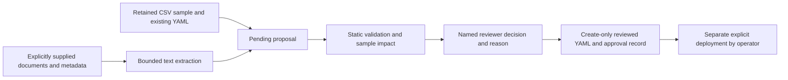

# Documentation-to-Data-Contracts (experimental)

Version 0.3.0-beta adds an isolated review workspace. Existing YAML monitoring,
quarantine, incident handling, replay and scheduler state keep their existing
meaning. A proposal is **never** a production contract merely because it parses,
has a citation, or passes a sample.

## Workflow



The existing YAML supplies dataset identity, source, primary key and operational
policy. This release augments an existing contract; it does not bootstrap a new
source/key definition from prose. This deliberate boundary avoids inventing
identity. Adding a new dataset still starts with a manually supplied base YAML.

Install `pip install -e '.[contracts,dashboard,test,dev]'`. PDF support is optional
at runtime; text, HTML and JSON extraction work without pypdf. Open the dashboard
and select **Contract proposals** to upload CSV/documents, generate, inspect
citations, edit rule JSON, verify selected rules, approve/reject and export.
Observatory remains the default workspace and reads monitoring history only.

## CLI

From the repository root, using the retained, attributed Madrid captures:

```bash
python scripts/contract_examples.py
sentinel proposal list --proposal-db state/example-proposals.sqlite
```

That command reproduces both examples, benchmark and impact reports without any
network access or production approvals. For an individual draft:

```bash
sentinel proposal generate --base configs/madrid_parking.yaml \
  --sample examples/contracts/parking/sample.csv \
  --sample-origin retained_official_capture_2026-11-11 \
  --document pdf=examples/contracts/parking/documentation.pdf \
  --document html=examples/contracts/parking/catalog.html \
  --document json=examples/contracts/parking/metadata.json
```

Use the returned ID and rule IDs in subsequent commands (PowerShell commands may
be entered on one line instead of using Bash line continuations):

```bash
sentinel proposal show --id ID --output reports/draft.json
sentinel proposal verify --id ID --rules RULE_ID_1,RULE_ID_2
sentinel proposal edit --id ID --rules-file rules.json --actor YOUR_NAME --reason 'Explain correction'
sentinel proposal verify --id ID --rules RULE_ID_1,RULE_ID_2
sentinel proposal decide --id ID --rules RULE_ID_1,RULE_ID_2 --actor YOUR_NAME --reason 'Citations and impact reviewed'
sentinel proposal activate --id ID --base configs/madrid_parking.yaml --output reviewed-contracts/parking.yaml --actor YOUR_NAME --reason 'Approved for explicit deployment review'
sentinel proposal export --id ID --output reports/table-schema.json
```

`rules.json` is a JSON array of the `proposal.rules` objects returned by `show`.
Editing creates a revision and clears verification and decisions. `decide`
approves by explicit operator request; `--reject` records rejection. Findings in
the sample require `--accept-impact` **and** a reviewer reason. Invalid/empty
samples and indeterminate added checks block approval even with this flag.
Re-verification clears previous approvals. Rule approval does not change its
documented/inferred/statistical basis.

`--document-url FORMAT=HTTPS_URL` explicitly fetches a catalog page or document.
Links, scripts and instructions within documents are never followed or executed.
Repeated `--document` / `--document-url` arguments are supported. `--statistics`
adds tentative completeness/uniqueness suggestions from the retained sample;
it never infers a primary key, allowed numeric range, or freshness threshold.

## Rules and evidence

Every rule includes a stable ID, existing executable `Check`, basis, extraction
method, rationale, limitations, uncertainty/conflict flags and pending approval.
Every documentary citation includes a document digest-linked ID, page number and
an exact quote checked against retained extracted text. Original bytes are kept
in the proposal workspace; raw hashes and re-extraction checks detect accidental
substitution of text or documents.

The conservative English/Spanish parser handles explicit field-scoped
required/unique statements, simple enums, enumerated numeric codes, explicit
numeric bounds and explicit maximum observation age. It also reads explicit
Table Schema JSON constraints. General CKAN metadata is retained as evidence,
but field names/types alone do not justify normative rules. Negation, examples,
modal language and wrapped enumerations cause abstention. Old dates produce
review warnings, not an assertion that the document is invalid. Contradictory
proposals cannot be verified until the reviewer resolves them in a revision.
This is a small pattern-based extractor, not general natural-language understanding.

Sample verification uses the **existing** normalization and quality evaluators.
It records input/candidate/base digests, fixed check time, per-rule counts and
examples, a YAML diff and existing constraints on affected fields. Generated
checks are appended; they never silently relax/replace existing constraints.
Source/key changes are outside the proposal editor. The verifier does not call
the network or the monitor and cannot write a monitoring baseline.

## Persistence and activation

`state/proposals.sqlite` is separate from `state/sentinel.sqlite`. It has its own
SQLite application ID, serialized transactions and an append-only application
journal containing revisions, verification receipts and actor/time/reason for
decisions. Monitoring databases are rejected before schema changes. The hash
chain is an integrity aid, **not** a signature, identity service or protection
against an adversary who can replace/roll back the whole database. Reviewer
names are operator-supplied; there is no authentication service in this beta.

Activation checks the current base text against the retained base and the
verified candidate digest, requires every selected rule to be approved, then
creates a new YAML and `.approval.json`. Existing files are never overwritten.
The scheduler only reads `configs/`; exported files are not automatically added
there. Production deployment and any resulting baseline/quarantine decisions
remain separate explicit operations. There is no retroactive history rewrite.

SQLite and filesystem exports are not one cross-resource atomic transaction.
An interrupted export/commit can leave an orphan reviewed file; its sidecar and
journal must be checked before deployment. Do not infer approval from a filename.
Back up the proposal SQLite file when idle (or with SQLite's backup API); it is
not placed on the public `sentinel-state` branch by the monitoring workflow.
Proposal state can contain private uploaded documents; share it deliberately.

Limits: 8 MB/document, 200 PDF pages, 500,000 extracted characters/document,
20 documents, 10,000 sample rows and 500 proposal rules. No OCR, table-layout
reconstruction, model training or live-source guarantees. PDF parsing is local;
these limits do not constitute hostile-file process isolation.

## Optional semantic model

The default path makes **zero model calls** and needs no model credentials.
An opt-in [Ollama-compatible chat endpoint](https://docs.ollama.com/api/chat)
can add semantic suggestions:

```bash
sentinel proposal generate --base configs/madrid_parking.yaml --sample examples/contracts/parking/sample.csv --document pdf=examples/contracts/parking/documentation.pdf --model YOUR_INSTALLED_MODEL --allow-model-documents
```

The default endpoint is local `http://127.0.0.1:11434`. External endpoints require
HTTPS, `--model-endpoint` and `--allow-external-model`. Document-text transfer also
requires the explicit consent flag for local models. Only document text/IDs and
field names are sent; sample values, YAML source URLs, environment variables and
credentials are not included. A document itself can contain sensitive text:
inspect it before consenting. Endpoint credentials in URLs are rejected. The
adapter does not read API-key variables or support authenticated remote APIs.

One request, at most 64,000 input characters, 4,096 requested output tokens,
256,000 response bytes, HTTP timeouts and no redirects/tools/function execution.
Costs depend on the chosen model/provider; local inference uses local compute.
Token limits are a budget request, not a provider-independent billing guarantee.
Responses must satisfy a strict typed schema and exact-citation validation.
All model rules remain uncertain **inferences**. A model cannot approve itself,
rewrite the base contract, add executable code or activate rules. Prompt
injection can still yield a misleading cited inference, so semantic human review
is mandatory. Only mock-model behavior was tested for this release; actual
extraction quality, latency and cost of a real model are unmeasured.

## Standards and reuse decisions

[ODCS](https://bitol-io.github.io/open-data-contract-standard/latest/fundamentals/)
provides a much wider contract framework (schema, quality, ownership and service
expectations). It was studied, but a complete ODCS exporter would imply mappings
that Sentinel cannot faithfully supply. No ODCS conformance is claimed.

[Frictionless Table Schema v1](https://specs.frictionlessdata.io/table-schema/)
is a better bounded interchange target. `proposal export` emits a `schema` plus a
machine-readable `mapping` of mapped and omitted rules. For Sentinel-normalized
string records it maps field/key declarations, zero-tolerance completeness and
unconditional string domains when whitespace trimming is configured. Domains
that reject blank values export a required constraint too. It omits conditional
checks, numeric parsing/tolerance differences, uniqueness of blanks, temporal
rules, legacy checks, quarantine and operational policy, rather than changing
their meaning. This is a portable **subset**, never a replacement for the YAML.
Tests validate the descriptor against the retained official v1 JSON Schema.

HTTPX, Pydantic, PyYAML and pypdf are reused, with their upstream licenses.
No competing observability engine was copied or added: the existing evaluator
already provides the execution semantics required for proposal verification.
The implementation adds a review/evidence layer instead of a second validator.
